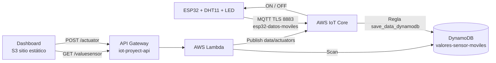

# Ruta Salud · Arquitectura serverless para IoT

**Actividad 3 · Inteligencia Artificial aplicada a Internet de las Cosas**

## Integrantes

| Nombre completo | Código universitario |
| --- | --- |
| Didier Manuel Castro Vasquez | 22606316 |
| Ingrid Valentina Sánchez Manzano | 22610485 |
| Jesús Bolaños Botina | 22602601 |
| Daniel Caicedo Villegas | 22601469 |

## Caso de uso

Monitoreo de temperatura y humedad del área de atención de **unidades móviles de salud**. La temperatura y la humedad pueden cambiar durante la jornada por el clima, la ventilación y la apertura de puertas. El sistema registra las mediciones de forma continua, las muestra en un dashboard y controla un actuador, un LED que representa la ventilación de la unidad: se activa automáticamente cuando la temperatura supera un límite y también a distancia desde el dashboard.

Es un prototipo académico: no procesa datos de pacientes ni constituye un sistema clínico certificado.

## Arquitectura



La arquitectura no usa servidores propios. La página de S3 no tiene credenciales de AWS: consulta los datos y envía las órdenes a través de API Gateway, y la Lambda es la que tiene permisos sobre DynamoDB y AWS IoT.

| Servicio | Recurso | Función |
| --- | --- | --- |
| AWS IoT Core | Thing con certificado X.509 | Recibe las lecturas del ESP32 por MQTT y le entrega las órdenes |
| Regla de IoT | `save_data_dynamodb` | Guarda cada mensaje de `esp32-datos-moviles` en DynamoDB |
| DynamoDB | `valores-sensor-moviles` | Almacena las mediciones para su consulta |
| Lambda | `lambda/lambda_function.py` | Lee DynamoDB y publica las órdenes del LED |
| API Gateway | `iot-proyect-api`, etapa `Pruebas` | Expone `GET /valuesensor` y `POST /actuator` |
| S3 | `dashboard-iot-monitoreo-moviles` | Aloja el dashboard como sitio web estático |

### Topics MQTT

| Topic | Publica | Recibe | Contenido |
| --- | --- | --- | --- |
| `esp32-datos-moviles` | ESP32 | Regla de IoT | `{"timestamp", "humidity", "temperature", "device_id"}` |
| `data/actuators` | Lambda | ESP32 | `{"message": "ON"}` o `{"message": "OFF"}` |

## Estructura del repositorio

```text
firmware/aws_esp32/
  aws_esp32.ino             Firmware del ESP32
  credentials.example.h     Plantilla de credenciales (copiar como credentials.h)
lambda/
  lambda_function.py        Lambda de lecturas y actuador
dashboard/
  index.html, app.js, style.css
  config.js                 URL de la API y rutas
  static/chart.umd.min.js   Chart.js para las gráficas
```

`credentials.h` y los certificados `.pem` están excluidos de Git: contienen la llave privada del dispositivo y la clave del Wi-Fi.

## Paso a paso

Todo se crea en la región **us-east-1 (N. Virginia)**. En AWS Academy se usa el rol **LabRole** donde se pida un rol de IAM.

### 1. AWS IoT Core: dispositivo y certificado

1. En **AWS IoT → Administrar → Objetos (Things)**, crear un objeto para el ESP32.
2. Generar automáticamente un certificado y descargar: el certificado (`*-certificate.pem.crt`), la llave privada (`*-private.pem.key`) y `AmazonRootCA1.pem`. La llave privada solo se puede descargar en ese momento.
3. Crear una política y asociarla al certificado. Ejemplo con permisos limitados al dispositivo (reemplazar `CUENTA` y `NOMBRE_DEL_THING`):

```json
{
  "Version": "2012-10-17",
  "Statement": [
    {"Effect": "Allow", "Action": "iot:Connect",
     "Resource": "arn:aws:iot:us-east-1:CUENTA:client/NOMBRE_DEL_THING"},
    {"Effect": "Allow", "Action": "iot:Publish",
     "Resource": "arn:aws:iot:us-east-1:CUENTA:topic/esp32-datos-moviles"},
    {"Effect": "Allow", "Action": "iot:Subscribe",
     "Resource": "arn:aws:iot:us-east-1:CUENTA:topicfilter/data/actuators"},
    {"Effect": "Allow", "Action": "iot:Receive",
     "Resource": "arn:aws:iot:us-east-1:CUENTA:topic/data/actuators"}
  ]
}
```

4. Copiar el **endpoint** de **AWS IoT → Configuración**, con el formato `xxxx-ats.iot.us-east-1.amazonaws.com`.

### 2. DynamoDB

Crear la tabla `valores-sensor-moviles` con:

| Clave | Nombre | Tipo |
| --- | --- | --- |
| Partición | `device_id` | String |
| Ordenación | `timestamp` | String |

### 3. Regla de AWS IoT

En **AWS IoT → Enrutamiento de mensajes → Reglas**, crear `save_data_dynamodb`:

- **SQL:** `SELECT * FROM 'esp32-datos-moviles'`
- **Acción:** DynamoDB, tabla `valores-sensor-moviles`

| Campo | Valor |
| --- | --- |
| Partition key / type / value | `device_id` / STRING / `${device_id}` |
| Sort key / type / value | `timestamp` / STRING / `${timestamp}` |
| Write message data to this column | `payload` |
| IAM role | LabRole |

El nombre y el tipo de las claves deben coincidir exactamente con los de la tabla. Si no coinciden, AWS descarta el mensaje sin mostrar error. Se recomienda agregar una **acción de error** hacia CloudWatch Logs para ver estos fallos.

### 4. Lambda

1. Crear una función **Python 3.12** con el rol **LabRole**, que necesita `dynamodb:Scan` sobre la tabla e `iot:Publish` sobre `data/actuators`.
2. Pegar el contenido de `lambda/lambda_function.py` y pulsar **Deploy**.
3. Variables de entorno opcionales: `TABLE_NAME` (por defecto `valores-sensor-moviles`), `DEVICE_ID` (`esp32_01`) y `ACTUATOR_TOPIC` (`data/actuators`).

La función responde a:

| Método y ruta | Acción |
| --- | --- |
| `GET /valuesensor` | Devuelve `{"items": [...]}` con las lecturas, de la más reciente a la más antigua |
| `POST /actuator` | Recibe `{"message": "ON"}` o `{"message": "OFF"}` y lo publica en `data/actuators` |

### 5. API Gateway

En la API REST `iot-proyect-api`:

1. Crear el recurso `/valuesensor` con el método **GET**.
2. Crear el recurso `/actuator` con el método **POST**.
3. En ambos métodos, integración **Lambda function** con **Lambda proxy integration** activada, apuntando a la función del paso 4.
4. En cada recurso, **Enable CORS** con su método y OPTIONS, y `Access-Control-Allow-Origin: *`.
5. **Deploy API** en la etapa `Pruebas`. Los cambios no se aplican hasta desplegar.

URL de invocación: `https://btv6k23frl.execute-api.us-east-1.amazonaws.com/Pruebas`

### 6. Dashboard en S3

1. En `dashboard/config.js`, configurar `API_URL` con la URL de invocación, `READINGS_PATH: "/valuesensor"` y `ACTUATOR_PATH: "/actuator"`.
2. Crear el bucket `dashboard-iot-monitoreo-moviles`.
3. Subir el **contenido** de `dashboard/` a la raíz del bucket, conservando la carpeta `static/`.
4. **Propiedades → Alojamiento de sitios web estáticos:** habilitar, con documento de índice `index.html`.
5. **Permisos → Bloquear acceso público:** desactivar **Bloquear todo el acceso público**.
6. **Permisos → Política del bucket:**

```json
{"Version":"2012-10-17","Statement":[{"Sid":"LecturaPublicaDashboard","Effect":"Allow","Principal":"*","Action":"s3:GetObject","Resource":"arn:aws:s3:::dashboard-iot-monitoreo-moviles/*"}]}
```

La política permite solo leer los archivos de la página. Dashboard publicado: http://dashboard-iot-monitoreo-moviles.s3-website-us-east-1.amazonaws.com

El dashboard muestra la última medición, el estado de recepción, gráficas de temperatura y humedad y la tabla de mediciones. Permite filtrar por fechas, **descargar el CSV** y **encender o apagar el LED**.

### 7. Firmware del ESP32

**Hardware (ESP32 clásica, DevKit):**

| Componente | Pin |
| --- | --- |
| DHT11 DATA | GPIO 5 |
| DHT11 VCC / GND | 3.3 V / GND |
| Actuador | LED azul integrado, GPIO 2 |

**Arduino IDE:**

1. En **Preferencias**, agregar la URL de placas `https://espressif.github.io/arduino-esp32/package_esp32_index.json` e instalar **esp32 de Espressif Systems**.
2. Instalar las librerías **PubSubClient** (Nick O'Leary), **ArduinoJson** (Benoit Blanchon) y **DHT sensor library** (Adafruit).
3. Copiar `credentials.example.h` como `credentials.h` y completar: red Wi-Fi de 2.4 GHz, nombre del Thing, endpoint y el contenido de los tres certificados.
4. Seleccionar la placa **ESP32 Dev Module** y el puerto COM. Usar un cable USB de **datos**: con un cable solo de carga la placa enciende, pero Windows no la detecta.
5. Cargar `firmware/aws_esp32/aws_esp32.ino`. Si se queda en `Connecting...`, mantener presionado el botón **BOOT**.
6. En el Monitor serie a **9600** baudios deben aparecer `AWS IoT Connected!` y las publicaciones cada 10 s.

El firmware sincroniza la hora por NTP antes de publicar, descarta lecturas inválidas del DHT11 y se reconecta y vuelve a suscribirse a `data/actuators` si se pierde la conexión.

**Control del LED.** Funciona de dos formas que no se anulan entre sí:

| Forma | Comportamiento |
| --- | --- |
| Automática por temperatura | Enciende el LED cuando la temperatura sube a `TEMP_ON` (30 °C) y lo apaga cuando baja a `TEMP_OFF` (29 °C) |
| Manual desde el dashboard | Los botones Encender y Apagar envían `ON` u `OFF` por `data/actuators` |

El control automático solo actúa en el momento en que la temperatura cruza un límite, no en cada lectura. Por eso una orden del dashboard se mantiene hasta que se envíe otra o hasta el siguiente cruce de límite. La diferencia de 1 °C entre los dos límites evita que el LED parpadee cuando la temperatura oscila cerca del umbral. Los límites se cambian en las constantes `TEMP_ON` y `TEMP_OFF` del firmware.

## Pruebas

### Verificación con el ESP32

1. **Conexión.** Con el firmware cargado, abrir el Monitor serie a 9600 baudios. Deben aparecer en orden:

   ```text
   WiFi connected, IP: 192.168.x.x
   Sincronizando hora... OK
   AWS IoT Connected!
   Humidity: 65.0%  Temperature: 27.0 C
   Publicado: {"timestamp":...,"humidity":65,"temperature":27,"device_id":"esp32_01"}
   ```

2. **Almacenamiento.** En **DynamoDB → `valores-sensor-moviles` → Explorar elementos**, comprobar que aparecen registros nuevos de `esp32_01` cada 10 s, con los mismos valores del Monitor serie.
3. **Dashboard.** Abrir el dashboard publicado en S3. La tarjeta de estado debe indicar "Recibiendo mediciones", y las gráficas y la tabla deben actualizarse con las lecturas del sensor. Descargar el CSV y revisar que contiene esas lecturas.
4. **Actuador desde el dashboard.** Pulsar **Encender** y **Apagar**. El LED azul del GPIO 2 debe responder, y el Monitor serie debe mostrar `LED turned ON (dashboard)` y `LED turned OFF (dashboard)`.
5. **Actuador por temperatura.** Calentar el DHT11 con la mano o el aliento hasta superar 30 °C: el LED se enciende y aparece `Temperatura alta: LED turned ON (automatico)`. Al bajar a 29 °C o menos se apaga con `Temperatura normal: LED turned OFF (automatico)`.
6. **Estabilidad.** Dejar el ESP32 encendido al menos 20 minutos y comprobar que el dashboard sigue indicando "Recibiendo mediciones" sin interrupciones.

### Resultados

| Prueba | Resultado |
| --- | --- |
| AWS IoT → regla → DynamoDB | Correcto |
| `GET /valuesensor` con CORS | Correcto |
| `POST /actuator` → `data/actuators` | Correcto: ON y OFF recibidos |
| Dashboard publicado en S3: datos, gráficas y LED | Correcto, sin errores en el navegador |
| Firmware compilado para ESP32 Dev Module | Correcto |
